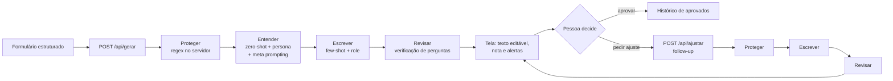
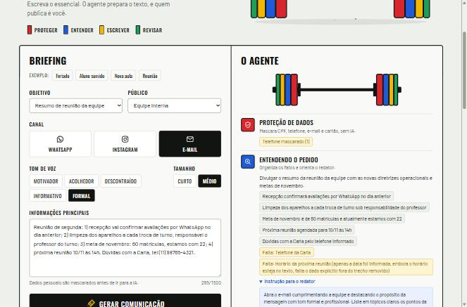
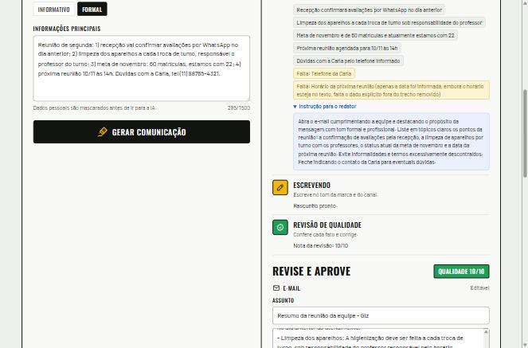
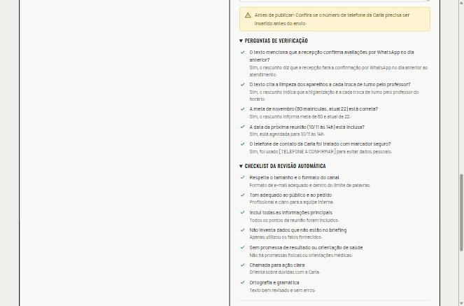

<p align="center">
  
</p>

<h1 align="center">Giz · Assistente de comunicação</h1>

<p align="center">
  Agente de IA que transforma um briefing curto em comunicações prontas para uma rede de academias,
  com proteção de dados, revisão automática e aprovação humana.
</p>

<p align="center">
  
  
  
  
  
  
</p>

<p align="center">
  <a href="https://giz-assistente-ia.vercel.app"><strong>Acessar a solução</strong></a> ·
  <a href="https://giz-assistente-ia.vercel.app/?demo">Modo demonstração</a> ·
  <a href="docs/parte-teorica.md">Parte teórica</a>
</p>

---

## Sumário

- [O problema](#o-problema)
- [A solução](#a-solução)
- [Fluxo do agente](#fluxo-do-agente)
- [Técnicas de prompt aplicadas](#técnicas-de-prompt-aplicadas)
- [Principais instruções](#principais-instruções)
- [Ferramentas](#ferramentas)
- [Evidências](#evidências)
- [Como usar](#como-usar)
- [Rodar localmente](#rodar-localmente)
- [Deploy na Vercel](#deploy-na-vercel)
- [Estrutura de pastas](#estrutura-de-pastas)
- [Como o projeto atende ao desafio](#como-o-projeto-atende-ao-desafio)
- [Limitações conhecidas](#limitações-conhecidas)

## O problema

Na Giz, uma rede fictícia de academias de bairro, a recepção e a gerência escrevem todo dia os mesmos textos: aviso de feriado, aula nova, mensagem para aluno que sumiu, resumo de reunião. Cada pessoa escreve de um jeito. Os textos saem longos, com tom inconsistente, às vezes com promessas que a marca não pode fazer ("perca 10 kg") e às vezes com dados pessoais de alunos.

## A solução

Um formulário estruturado alimenta um agente de quatro etapas. Cada etapa tem um papel e uma instrução próprios, e o progresso aparece na tela em tempo real: a cada etapa concluída, um par de anilhas entra na barra.

| Etapa | Responsável | O que faz | Usa IA |
|---|---|---|---|
| Proteger | Servidor | Mascara CPF, telefone, e-mail e cartão antes de qualquer envio | Não |
| Entender | Bia, coordenadora | Classifica o pedido, lista fatos, lacunas e riscos e escreve a instrução para o redator | Sim |
| Escrever | Leo, redator | Escreve seguindo o guia da marca, as regras do canal e um exemplo do canal | Sim |
| Revisar | Marta, revisora | Cria perguntas de verificação sobre os fatos, confere o checklist, corrige e dá uma nota | Sim |

Depois disso, uma pessoa lê, edita se quiser, pede ajustes em linguagem natural e aprova. Nada é publicado automaticamente.

## Fluxo do agente



As duas rotas respondem em streaming (NDJSON): cada etapa vira um evento assim que termina.

## Técnicas de prompt aplicadas

| Técnica | Onde | Como |
|---|---|---|
| Zero-shot | Entender | A triagem classifica e organiza o pedido sem nenhum exemplo, só com instruções e formato JSON. |
| Persona e role prompting | As três etapas com IA | Bia (coordenadora há 8 anos), Leo (ex-professor que virou redator) e Marta (revisora desconfiada), cada uma com uma responsabilidade. |
| Meta prompting | Entender → Escrever | A coordenadora escreve o prompt que o redator vai seguir (`instrucao_para_redator`). A instrução aparece na tela. |
| Few-shot | Escrever | Antes do pedido real, o modelo recebe um par briefing → resposta do mesmo canal, como turnos de conversa. |
| Verificação de perguntas e respostas | Revisar | A revisora cria de 3 a 5 perguntas sobre os fatos do briefing, responde olhando só para o rascunho e corrige o que falhou. |
| Follow-up | Pedir ajuste | A conversa continua: o modelo recebe o briefing, a sua última versão (com as edições da pessoa) e o novo pedido. A revisão recebe o pedido como regra extra. |

## Principais instruções

Os prompts ficam em [`api/_lib/prompts/`](api/_lib/prompts), separados da lógica.

- **Guia de marca** ([`marca.js`](api/_lib/prompts/marca.js)): voz energética e acolhedora, sem julgamento de corpo. Regras inegociáveis: nunca prometer resultado físico, nunca dar orientação de saúde, nunca inventar dados (usar `[HORÁRIO A CONFIRMAR]` quando faltar algo) e nunca incluir dados pessoais.
- **Regras por canal:** limites de tamanho e formato para WhatsApp, Instagram e e-mail.
- **Proteção contra injeção:** o texto do colaborador vai entre `<briefing>` e `<pedido_de_ajuste>` e é tratado como dado. As opções dos campos de seleção são validadas no servidor.
- **Saídas estruturadas:** todas as etapas respondem em JSON (`responseMimeType: application/json`), o que permite encadear uma etapa na outra.
- **Temperatura por tarefa:** 0,2 para triagem e revisão (consistência) e 0,8 para escrita (variedade).

## Ferramentas

| Camada | Escolha | Motivo |
|---|---|---|
| Modelo | Google Gemini `gemini-3.5-flash-lite`, com `gemini-flash-lite-latest` de reserva | Leve e rápido (cerca de 1,5 s por chamada), plano gratuito, bom em português e com saída JSON nativa |
| Back-end | Funções serverless Node.js na Vercel (`api/`) | A chave da API fica só no servidor |
| Front-end | HTML, CSS e JavaScript em módulos, sem framework | Simples de ler, avaliar e hospedar |
| Design | Oswald e Barlow, ícones e ilustrações em SVG próprios, diretrizes do [Impeccable](https://impeccable.style) | Identidade de academia, legível no balcão |
| Pacotes | pnpm | Padrão do projeto |

## Evidências

| Tela inicial | Agente em etapas | Revisão e verificação |
|---|---|---|
|  |  |  |

Nos testes com o modelo real, uma geração completa levou cerca de 5 s, e um ajuste por follow-up cerca de 3,5 s.

## Como usar

1. Escolha um exemplo pronto ou preencha objetivo, público, canal, tom e tamanho.
2. Escreva as informações principais: fatos, datas e horários.
3. Clique em **Gerar comunicação** e acompanhe as etapas.
4. Leia o alerta "Antes de publicar" e confira as perguntas de verificação.
5. Edite o texto ou peça um ajuste ("Sem emojis", "Comece pelo horário").
6. Clique em **Aprovar** para salvar no histórico.

Para apresentar sem gastar cota da IA, acrescente `?demo` ao endereço.

## Rodar localmente

Requisitos: Node.js 20.11 ou mais novo e pnpm.

```bash
pnpm install
cp .env.example .env
pnpm dev
```

No `.env`, preencha `GEMINI_API_KEY` com uma chave gerada em [aistudio.google.com](https://aistudio.google.com/apikey). O site abre em `http://localhost:3000`.

## Deploy na Vercel

1. Importe este repositório em **Vercel → Add New → Project** (Framework Preset: *Other*).
2. Em **Settings → Environment Variables**, crie `GEMINI_API_KEY`.
3. Faça o deploy. O [`vercel.json`](vercel.json) já serve a pasta `public/` e dá 60 s para cada função.

## Estrutura de pastas

```
api/
  gerar.js                rota POST que roda o agente completo
  ajustar.js              rota POST do ajuste por follow-up
  _lib/
    agente.js             orquestra as etapas
    gemini.js             cliente da API, com modelo reserva
    privacidade.js        mascaramento de dados pessoais
    validacao.js          validação das entradas
    http.js               limite de uso e resposta em streaming
    erros.js
    prompts/
      marca.js            guia de marca, canais e briefing
      entender.js         zero-shot, persona e meta prompting
      escrever.js         role prompting e exemplos few-shot
      revisar.js          verificação de perguntas e respostas
      ajustar.js          conversa de follow-up
public/
  index.html
  css/style.css
  js/
    main.js               liga a interface aos serviços
    dados/exemplos.js     briefings de exemplo e sugestões de ajuste
    servicos/api.js       leitura do streaming das rotas
    servicos/demo.js      simulação do agente (modo ?demo)
    servicos/armazenamento.js  aprovados no localStorage
    interface/tela.js     etapas, resultado e anúncios para leitor de tela
    interface/historico.js     cartões de aprovados
    interface/dialogo.js  diálogo com o texto aprovado
  assets/
    marca/logo.svg
    icones/icones.svg
    ilustracoes/hero-barra.svg
scripts/
  servidor-local.js       servidor de desenvolvimento (a Vercel não usa)
docs/
  parte-teorica.md
  evidencias/
```

## Como o projeto atende ao desafio

| Requisito | Onde está |
|---|---|
| Entrada estruturada | Formulário com objetivo, público, canal, tom e tamanho (opções fechadas) e um campo de informações |
| Uso de um LLM para interpretar e gerar | Gemini interpreta (triagem), gera (redação) e avalia (revisão) |
| Prompts claramente definidos | Pasta [`api/_lib/prompts/`](api/_lib/prompts), um arquivo por etapa |
| Fluxo automatizado ou agente | Quatro etapas encadeadas, em que cada saída alimenta a próxima, mais o ciclo de ajuste |
| Saída coerente com contexto, público e objetivo | Regras por canal, guia de marca, exemplo do canal e checklist de revisão |
| Evidências | [`docs/evidencias/`](docs/evidencias) |
| Fluxo construído | Diagrama acima e etapas visíveis na própria tela |
| Link da solução | [giz-assistente-ia.vercel.app](https://giz-assistente-ia.vercel.app) |
| README | Este documento |
| Parte teórica | [`docs/parte-teorica.md`](docs/parte-teorica.md) |

## Limitações conhecidas

- O limite de uso por IP fica em memória e reinicia junto com a função: é uma proteção básica.
- O mascaramento por regex pega formatos comuns, mas não nomes, endereços ou dados de saúde escritos por extenso.
- A revisão é feita por um modelo da mesma família que escreveu, então pode deixar passar o mesmo tipo de erro.
- O histórico de aprovados fica só no navegador de quem aprovou.

---

<p align="center">
  Giz é uma rede de academias fictícia, criada para o desafio "Seu Primeiro Agente de IA".
</p>
